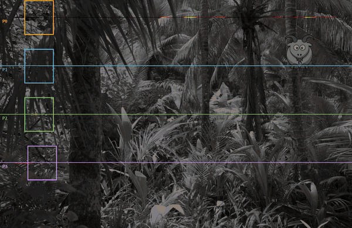
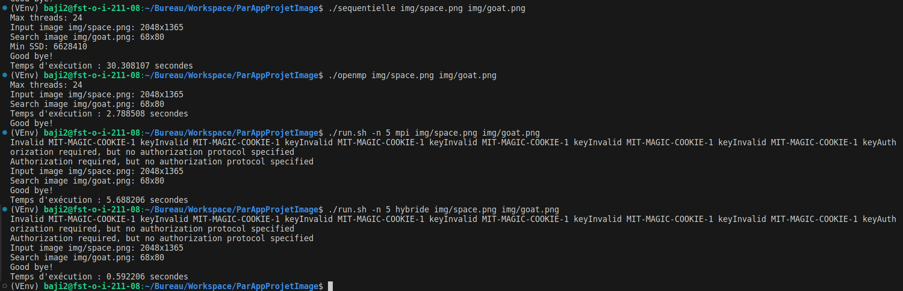

# Recherche de sous-image parallèle (OpenMP, MPI)

Projet de calcul parallèle du master Informatique ISICG (Université de Limoges, 2024), en C.

Le programme recherche la position d'une sous-image dans une image. Il existe en quatre versions pour comparer les approches de parallélisation :

- `sequentielle` : version de référence ;
- `openmp` : parallélisme en mémoire partagée ;
- `mpi` : parallélisme en mémoire distribuée sur un cluster ;
- `hybride` : MPI entre les nœuds, OpenMP dans chaque nœud.



*Visualisation du découpage : l'image est partagée en 4 bandes de lignes, une par processus (P0 à P3), comme dans la version MPI. Chaque processus calcule la somme des carrés des différences (SSD) pour toutes les positions de sa bande ; la carte de chaleur montre les positions les plus ressemblantes, et le cadre rouge la position retenue après la réduction du minimum. L'animation a été générée à part, avec la même formule de SSD que le programme ; elle trouve la même position que lui.*



## Compilation et exécution

```bash
make
./sequentielle
./openmp
./run.sh -n 4 ./mpi        # MPI sur les machines listées dans composition_cluster
./run.sh -n 4 ./hybride
```

Nécessite un compilateur MPI (`mpicc`) avec OpenMP. Les images de test sont dans `img/`. La bibliothèque stb_image est incluse dans `inc/`.

## Technologies

C, OpenMP, MPI.
